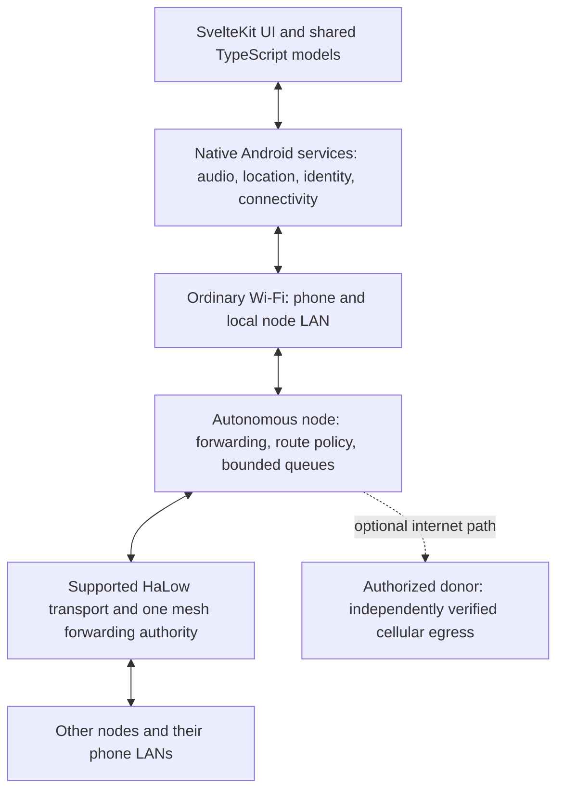
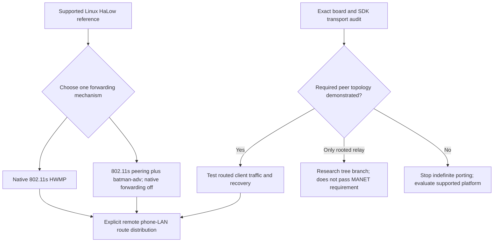
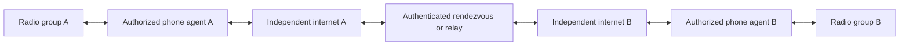

# Architecture roundtable: recommendation and decision gates

> Planning authority: the [delivery register](delivery-plan.md) owns execution order and status; [current decisions](decisions/README.md) records accepted scope versus proposals, and [requirement coverage](requirements-traceability.md) links tests/results. Sequences below are experiment detail. See [capabilities](../docs/capabilities.md) for implemented versus simulated behaviour.

6 November 2026. Five specialist agents reviewed the repository, researched primary sources and challenged peer positions in two rounds, coordinated by the main agent. Due to session capacity, reviewers rotated through three concurrent slots. This is a design recommendation, not measured hardware acceptance.

## Joint recommendation

Build an offline-first routed service network: native Android services own applications and phone networking; nodes own autonomous forwarding; HaLow supplies the node transport only where its exact driver supports the required topology. Prefer per-node phone LANs, explicit route ownership and authorized internet donors. Add optional internet transport between radio partitions without making local operation depend on servers.

The most credible functional reference is supported Linux/OpenWrt HaLow mesh. The ESP32-S3/XIAO path remains a bounded feasibility experiment. Neither is approved production hardware: no evidence establishes the complete arbitrary mobile mesh, A$45–75 basic-node budget and 48-hour continuous-runtime combination. This is the principal unresolved conflict, not a detail an algorithm can fix.

Do not silently return to the historical Pi build, substitute a rooted repeater tree for the intended mesh, or remove simultaneous voice to obtain an apparent pass. Hardware changes or requirement tradeoffs need an explicit owner decision after evidence.

## The room and what changed

| Specialist | Initial position / challenge | Outcome after peer review |
| --- | --- | --- |
| Radio architecture | MCU topology is the blocker; newer relay support makes station-only assumptions outdated | Linux mesh reference; exact-version MCU spike; no production hardware commitment |
| Android architecture | Hotspot is useful, native permanent attachment has better UX | Added hotspot-host reverse VPN as a genuine competing experiment; switching is fallback, not a proven necessity |
| Routing architecture | Prefer L3 boundaries and investigate Babel | Revised: no automatic Babel layer over an existing mesh; distinguish radio paths from LAN-prefix distribution |
| Security architecture | Membership, route ownership and donor rights must be distinct | Offline identities and authorized prefixes required; shared group authentication alone is insufficient |
| Systems/voice/power | Implementation must preserve voice and budget/runtime requirements | Derived airtime/energy checks; Linux is a reference rather than a budget pass; OpenMANET is not turnkey multi-donor support |

All five support these boundaries. Their agreement is conditional on experiments, not a claim that untested hardware or Android behaviour has been resolved. Radio explicitly withholds hardware endorsement; routing leaves production prefix-distribution selection open; Android leaves the donor mechanism open; security requires route authorization and lifecycle tests; systems withholds cost/runtime endorsement.

The discussions corrected three earlier assumptions: L3 alone cannot create missing radio peers; hotspot reversal may be achievable through a custom VPN rather than a Wi-Fi role change; a Linux mesh image does not automatically implement multiple donating phones.

## Responsibility diagram

UI/WebView suspension must not terminate native joined sessions. Phone departure must not terminate node transit forwarding. Internet loss must not terminate connected local-group functions. A phone-hosted donor or internet tunnel necessarily disappears when that phone leaves; withdraw those routes separately from radio routes.

## Alternatives considered

| Architecture | Attraction | Material limitation | Decision |
| --- | --- | --- | --- |
| ESP + HaLow S1G relay | Current small low-cost candidate; vendor relay functionality exists | Alpha rooted topology and unproven exact ESP integration; not arbitrary MANET | Bounded spike only |
| Linux/OpenWrt + supported HaLow 802.11s | Strongest existing path to genuine autonomous mesh | Complete cost, size and continuous energy unproven | Functional reference; possible platform branch after measurement |
| Flat LAN over batman-adv | Distributed-switch experience and established Linux implementation | Linux kernel dependency; broadcast, DHCP and partition handling | Benchmark alternative, not MCU assumption |
| Routed per-node LANs | Local DHCP survives isolation; confines broadcast; explicit policy | Must distribute remote LAN routes; roaming changes local IP | Preferred product boundary |
| Phone-led internet-only network | Can reconnect groups outside radio range | External coverage and active phones required; fails autonomous off-grid relay requirement | Optional additional transport |
| LoRa replacement | Attractive for small telemetry payloads | Not a like-for-like carrier for required simultaneous voice and general IP | No replacement recommendation |

## Radio and routing: choose the transport before the algorithm

Current vendor documentation describes S1G Relay roots, stations and repeaters and warns the API is alpha. Vendor discussion distinguishes this directed topology from Linux mesh. Do not infer complete MCU mesh from the existence of a relay example. [Relay API](https://morsemicro.github.io/mm-iot-sdk/framework/doc/html/group__MMWLAN__RELAY.html), [vendor topology explanation](https://community.morsemicro.com/t/mesh-network-with-mm8108-ekh05/1155).

The official ESP HaLow component `2.11.2-esp32-2` lists S3/MM6108 testing and AP/STA examples. Its dual-interface example refers to ordinary ESP SoftAP plus HaLow station; this is not evidence of concurrent HaLow mesh peers. Exact XIAO pins, BCF, SDK integration and permitted regional configuration remain separate gates. Pin an immutable source revision and compare the official component against Seeed's fork rather than assume the newest full MCU SDK is integrated. [ESP component](https://components.espressif.com/components/morsemicro/halow/versions/2.11.2-esp32-2/readme?language=en).

For a fixed laboratory pilot, explicit static LAN routes isolate forwarding from discovery. They are not the production mobility solution. In production, remote per-node prefixes require an existing routing implementation or another explicitly specified route-distribution mechanism. An L2 mesh does not supply those routes automatically.

| Algorithm/technology | Where it is useful | Why not adopt unconditionally |
| --- | --- | --- |
| HWMP | Native supported Linux 802.11s path forwarding | Driver/radio support and topology recovery need tests |
| batman-adv | Established Linux L2 mesh path system | Do not simultaneously enable an independent native mesh forwarding authority |
| Babel | Leading L3 evaluation for independent neighbour/tunnel links or needed prefix distribution | A `babeld` Linux implementation is not an ESP port; avoid redundant path selection |
| OLSRv2 | Proactive MANET alternative | More topology/MPR machinery than initially needed for 2–5 nodes |
| AODV | On-demand route discovery | Discovery/repair latency is unattractive for ongoing voice |
| RPL | Rooted constrained IPv6 LLNs | Poorer default fit for mobile any-to-any voice and changing internet donors |

Babel's sequence/feasibility mechanisms make it preferable to inventing a new distance-vector protocol if L3 dynamic routing is needed. Authenticate and authorize routes separately. Do not stack HWMP forwarding, BATMAN path selection and Babel without explaining which distinct problem each layer solves. [Babel](https://www.rfc-editor.org/rfc/rfc8966.html), [OLSRv2](https://www.rfc-editor.org/rfc/rfc7181.html), [AODV](https://www.rfc-editor.org/rfc/rfc3561.html), [RPL](https://www.rfc-editor.org/rfc/rfc6550.html), [Linux 802.11s](https://wireless.docs.kernel.org/en/latest/en/developers/documentation/ieee80211/802.11s.html).

## Android: compare three wireless paths before selection

Preferred UX: phone stays on the node AP, native Android code holds separate local-Wi-Fi and cellular sockets, and a userspace forwarding service donates cellular. This still requires a real TCP/UDP return-path implementation. An app HTTP proxy cannot meet all-app connectivity by itself.

Conventional hotspot donation is the fallback baseline. A new challenger is to retain the phone hotspot and receive via a VPN over its existing downstream-node link. This could avoid Wi-Fi switching, but is unproven. Android's VPN primitives and USB reverse-tethering projects establish useful mechanisms, not this hotspot topology. [Android VPN](https://developer.android.com/develop/connectivity/vpn), [network-specific sockets](https://developer.android.com/reference/android/net/Network), [Gnirehtet reference](https://github.com/Genymobile/gnirehtet).

| Experiment | Donation | Reception after cellular loss | Critical gate |
| --- | --- | --- | --- |
| Permanent node AP | Native app forwards to cellular-bound sockets | Ordinary node Wi-Fi or explicit consumer VPN | Userspace forwarding/lifecycle, DNS/TCP/UDP, weak cellular |
| Conventional phone hotspot | Android tethering | Hotspot off, phone joins node AP | Actual user actions, reconnection and phone restrictions |
| Phone hotspot plus reverse VPN | Android tethering while cellular works | Phone TUN -> protected local tunnel -> downstream node -> remote donor | Hotspot persists offline; app reaches node; tunnel avoids recursion; donor route withdrawn |

The reverse-VPN proposal covers routable application traffic in the supported Android user/profile, subject to documented VPN exclusions and platform restrictions. Do not infer coverage of every system/work-profile flow or that Android also routes tethered clients through it. A consumer VPN occupies the user's VPN slot and can conflict with another VPN. Preserve a documented Wi-Fi-switch fallback where feasible. Do not require universal phone AP/STA concurrency.

Time-box each path and test Pixel, Samsung A-series and another midrange model, with exact build/carrier records. Native service ownership, consent, network-scoped DNS, screen-off recovery, force-stop, quotas and phone energy are part of the decision, not polish after selection. Packet-to-socket libraries such as Hev/Sockstun are audit candidates only; Gnirehtet is an unmaintained reference, not a selected production dependency.

Begin Android testing on a controllable Linux AP/router with a separate uplink, so Android failures are isolated from HaLow uncertainty. First prove local access and ordinary all-app reception; then remove the uplink and verify local access survives. Record supported IP protocols and platform exceptions explicitly: DNS/TCP/UDP/QUIC success is useful evidence, not proof of arbitrary-IP transparency. Audit candidate packet-to-socket code at an exact revision before reuse: [Hev Android build](https://github.com/heiher/hev-socks5-tunnel/blob/main/Android.mk), [Sockstun](https://github.com/heiher/sockstun).

## Optional internet connection between partitions

Start with encrypted app messages/location/voice and stable identities across both transports. Add generic node-prefix tunneling only as its own deliverable: an app fallback does not rejoin all nodes at IP level. Use outbound connections and relay fallback for restrictive NATs. WebRTC ICE/TURN is a media/data candidate; WireGuard is a routed encryption candidate on a capable platform, not a discovery/relay/membership system or proven ESP dependency. [TURN](https://webrtc.org/getting-started/turn-server), [WireGuard](https://www.wireguard.com/protocol/).

Both sides require an independent working internet path. Bind underlay sockets accordingly; never use the tunnel-supplied mesh default to maintain that same tunnel. Allow only authorized remote prefixes, expire phone-agent routes and deduplicate messages when radio returns. Local offline startup must not need the relay, cloud credentials or runtime downloads.

## Services, security and performance

- Native Opus/WebRTC APM/NetEq remains the first voice candidate, with local authenticated signalling and phone-side mixing. Adaptive buffering, time stretching, concealment and DTX/FEC require measurements. Keep simultaneous speakers; no implicit single-speaker floor. [Voice plan](voice-audio-plan.md).
- Bounded fair queues and bulk shaping protect control and voice. Evaluate FQ-CoDel on Linux; do not assume its kernel implementation is an MCU library. Gateway choice uses verified reachability, expiry, hysteresis and flow affinity, not cellular bars alone. [FQ-CoDel](https://www.rfc-editor.org/rfc/rfc8290.html).
- Keep individual identities, group admission, owned prefixes, donor permission and consumer permission distinct. A shared authenticated routing key does not authorize a member to inject arbitrary routes. Babel MAC protects routing authentication/replay, not payload confidentiality. Use reviewed libraries, Android Keystore and explicit partition/rekey policy. Immediate global revocation during partitions is impossible. [Babel authentication](https://www.rfc-editor.org/rfc/rfc8967.html), [reordering update](https://www.rfc-editor.org/rfc/rfc9467.html), [Android Keystore](https://developer.android.com/privacy-and-security/keystore).
- OpenMANET is a reference, not a complete AuMaNET solution: its documented current internet-gate limit does not implement multiple dynamic donating phones. Preserve custom donor selection as explicit work. [OpenMANET networking](https://openmanet.github.io/docs/networking).

Derived capacity sanity check, not a measurement: the existing voice plan's illustrative 46.4 kbit/s directed stream on a five-node chain produces 40 ordered hop traversals for five simultaneous all-to-all talkers: about 1.856 Mbit/s aggregate hop-transmission load before MAC/retries/FEC. Two endpoint talkers produce 20 traversals, about 928 kbit/s. Spatial reuse and contention determine actual capacity; do not compare aggregate hop load directly to one link's headline PHY rate. Start with pairwise media, then evaluate an SFU/mixer only if measured savings justify its coordinator/failure dependency.

Derived energy sanity check: at an illustrative combined usable-energy/conversion factor of 0.8, nominal energy for 48 hours is `average watts × 48 / 0.8`. Thus 0.5 W requires 30 Wh, 1 W requires 60 Wh, and 2 W requires 120 Wh. These are scenarios, not predictions for either platform. Measure phone energy separately. No complete priced BOM or runtime result was produced by this roundtable.

## Execution order and decision record

Proposed time limits are engineering work budgets, not scheduled unattended jobs or delivery promises.

| Gate / work budget | Evidence to collect | Decision on failure |
| --- | --- | --- |
| Exact MCU integration audit: one engineering day | Immutable SDK/component revisions, pins/BCF/region, source/licence availability and supported modes | Stop speculative porting; document missing vendor support |
| Direct transport spike: two engineering days after toolchain works | Two nodes plus local phone APs; sustained bidirectional traffic, packet sizes, RAM, power | Correct board integration or evaluate another supported platform |
| Three-node topology spike: three engineering days | No A-C radio path; B phone-free; both-direction phone traffic; root loss, partition and merge | Tree result remains research; full mesh requirement stays unmet |
| Linux reference: same topology tests when suitable equipment is available | One supported forwarding stack, route distribution, measured recovery and baseline energy | Investigate exact driver/platform; do not claim reference pass |
| Android comparison: two engineering days per path on available phones | Complete DNS/TCP/UDP return path, cellular loss/recovery, locked screen and actual role-switch UX | Choose only demonstrated modes; expand implementation budget explicitly |
| Combined 2–5-node trial | Mixed voice/location/messages/shaped internet; donor swap; loops/MTU/security/resource limits | Profile bottleneck; no silent semantics reduction |
| Hardware selection gate | Itemized A$45–75 complete basic-node BOM and measured energy model; then actual 48-hour battery run | Present explicit cost/runtime/topology tradeoff for owner decision |

Two physical nodes can begin direct-link work; a third is indispensable for multi-hop acceptance. If equipment is unavailable, record the gate as not run, not failed. No purchase, firmware deployment or radio transmission was performed during this review.

The immediate recommendation is to run the radio capability and Android comparison spikes before building production routing or donation code. Implementation should reuse supported radio forwarding, established routing where needed, native media and cryptographic libraries; AuMaNET supplies product policy, identity binding, offline workflows and diagnostics.
