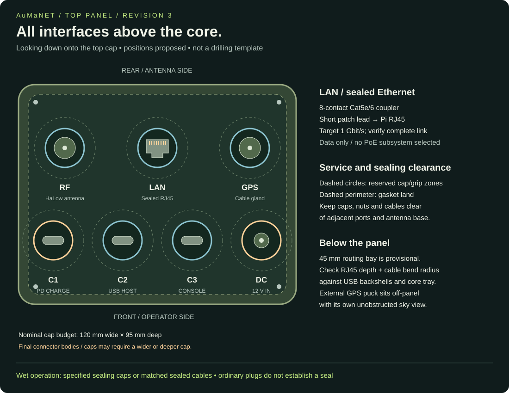

# Current design: one place to check the baseline

> **Active power decision - 5 November 2026:** battery pack, cell count, chemistry, charger, BMS and converter are **TBD**. Treat the battery assembly as a regulated **5 V output, 3 A continuous minimum (15 W)** module; 5 A / 25 W is a preferred headroom option, not a requirement already met. This is a nominal regulated voltage, not permission to exceed Pi voltage limits. Measure at the Pi under load. Earlier battery architectures below are archived options, not the active build. USB-C charging remains a reserved interface; its protocol and charge-and-run behaviour await the battery choice.

Updated 5 November 2026. This page describes the active design. Earlier entries in the decision history record what changed; they are not alternative assembly instructions.

## Current state

**Design prototype. Not ready for a full purchase or field reliance.** No complete AliExpress bill of materials, adapted enclosure, tested battery assembly or firmware recipe has been released. There is no guaranteed range or weather rating.

## What stays in the product

| Module | Current choice | Evidence / next check |

|---|---|---|

| Computer | Raspberry Pi 4B | User selected; exact purchased revision/storage still to record |

| HaLow radio | Heltec HC01P V2, 902–928 MHz variant, with matching HT-HC01PHAT | Identified from supplied listing capture; actual board and firmware combination untested |

| Local phone connection | Pi onboard ordinary Wi-Fi | Verify AP behaviour with chosen radio image |

| Position | EM7430 integrated GNSS over USB; LC76G fallback | GNSS antenna and actual firmware/data output to verify |

| Portable energy | Battery assembly TBD | Regulated 5 V / 3 A continuous minimum; 5 A option for headroom; runtime and dimensions TBD |

| Main Pi power | Regulated 5 V into Pi internal USB-C power inlet | Battery implementation deferred; verify actual loaded voltage and total demand |

| Case | ties1887-inspired battery base, central core, top wiring cap | One screw-fastened serviceable unit; derivative carrier/print files not yet made |

| Purchasing | AliExpress only | Exact matching listings required; manufacturer pages are technical references |

## External interfaces

- **C1 — CHARGE:** USB-C into the battery charging/power system.

- **C2 — ACCESSORY:** USB-C downstream host for supported digital USB accessories.

- **LAN:** sealed eight-contact RJ45 coupler connected to Pi Ethernet; no PoE subsystem.

- **RF:** one interchangeable HaLow antenna through a verified RF bulkhead.

- **GPS:** sealed coax exit to a matched GNSS antenna on EM7430; LC76G receiver is fallback.
- **LTE MAIN / AUX:** two cellular antenna paths to the EM7430; see revision 7 top view.

- **Upper side:** recessed sealed power/shutdown button and blanked headset/PTT provision.

- **Status:** battery, power/boot and mesh-link indicators. They do not imply message acknowledgement or participant wellbeing.

The removed USB service console, third USB-C and 12 V barrel input are not in the active BOM. Optional headset/PTT remains blanked until its pinout and electronics are chosen.

## Module boundaries

| Replaceable assembly | Boundary | Keep stable when replacing it |

|---|---|---|

| Compute/radio tray | Pi mounts, HAT header, 5 V power harness, RF pigtail | Logic voltage, GPIO use, power capacity and board-specific firmware |

| Battery base | Keyed pack connector, fuse, temperature sensing and mounting | Pack chemistry, voltage/topology, charger configuration and fault limits |

| Power service rail | Charge input, battery/system rail, regulated 5 V, shutdown handshake | No reverse feed, clean source transitions and orderly shutdown |

| Top insert | Gasket land, port apertures, capped/mated seals | Panel thickness, cap access, cable bends and service access |

| GNSS assembly | UART, regulated receiver power, antenna coax | Logic levels, antenna bias, connector, data protocol and receiver identity |

| RF kit | Bulkhead, feed cable, passive antenna | Band coverage, connector polarity, gain/loss and legal power profile |

These are interface requirements, not released connector pinouts. Connector part numbers and keyed harness drawings are required before a builder-facing wiring release.

## Prototype evidence still needed

| Requirement | Current evidence | What proves readiness |

|---|---|---|

| Off-the-shelf AliExpress parts | One identified Heltec listing capture; other models are candidates | Complete revision-specific listing register and received-parts checks |

| No developer skills for normal build | Staged guide and offline handbook | Another tech-savvy builder follows the guide without editing code |

| Simple assembly | Zone/layout and module boundaries documented | As-built harnesses, fit photos, fastener list and repeatable assembly |

| Six-cell charging and shutdown | Power architecture only | Chosen modules pass load, charge, cutoff, temperature and restart checks |

| Heltec radio firmware | Community HC01P report and manufacturer resources | Exact V2 image/overlay/BCF record with bench results |

| GPS | Receiver/HAT interface documentation | Outdoor fix and recovery on the actual image/hardware |

| Modular upgrades | Replacement checklist | One demonstrated module replacement and regression record |

| Offline messaging and voice/data | Requirements and community software references | Two-node then three-node application trials, with phone sleep/reconnect |

| Field usability | Panel/control proposals | Glove-use, cable access, indicator comprehension and runtime tests |

| Safe Australian operation | Regulatory references | Equipment/profile review for the chosen occupied channel and antenna |

## Firmware and power evidence

The downloaded OpenMANET 1.8.0 SPI image has a confirmed GPIO mapping mismatch with the Heltec HAT. The firmware review includes exact image/overlay hashes and a review-only adaptation tool. It is not a tested build image. See [firmware review](firmware-review.md) and [power selection review](power-review.md).

## Next hardware stage

See [operating hardware and community comparison](operating-hardware.md) and the [BOM](parts.html). Freeze the compute/radio stack, GNSS receiver harness, RF pigtail, cooling and top-panel interfaces before enclosure CAD. Battery selection is deferred behind its regulated 5 V interface.

## Active cellular and top-panel revision 7

The user now includes a **Sierra EM7430 on a USB WWAN adapter** as the cellular/GNSS candidate. It is not a PCIe data connection to the Pi: the adapter carries USB, SIM and module power. Internet uplink is the purpose; native carrier calls and SMS features are outside this project's scope. Exact adapter, firmware, carrier operation, GNSS output and power remain verification items.

| Position viewed from above | Interface | Internal destination |
|---|---|---|
| Rear left | HaLow antenna bulkhead | Existing Heltec radio through its verified matching pigtail |
| Rear right | LTE MAIN antenna bulkhead | EM7430 MAIN coax socket |
| Front left | LTE AUX antenna bulkhead | EM7430 AUX diversity/MIMO coax socket |
| Front right | GNSS sealed coax exit | EM7430 dedicated GNSS socket; cable to compatible sky-facing patch/puck |
| Centre rear | Sealed Ethernet | Short eight-contact patch cable to Pi LAN |
| Centre front left | C1 USB-C CHARGE | Future battery charging system; protocol TBD |
| Centre front right | C2 USB-C ACCESSORY HOST | Compliant downstream host interface from Pi USB |

Four RF paths are reserved, not necessarily four upright antennas. GPS may use a remote puck through the gland. LTE MAIN and AUX need two suitable cellular elements; they do not share the HaLow antenna. Exact microcoax mating parts, bulkhead seals, LTE band coverage, GNSS bias and cable loss must be selected from the actual module/antenna documentation. Keep short, strain-relieved coax runs.

The **Pi4 onboard Wi-Fi/Bluetooth antenna** provides local access; no new Bluetooth or Wi-Fi bulkhead is included. Keep its antenna area away from metal heat spreaders, battery and cabling, and verify phone access through the case. No GPIO antenna pinout is involved. Bluetooth phone networking is not assumed or required.

Corner placement maximises available separation within this concept, but proves no RF isolation. Test GNSS acquisition/fix retention during LTE uplink and HaLow traffic, LTE signal/throughput with both elements, and local Wi-Fi. The 120 x 95 mm cap is still a provisional envelope: check seven interface bodies, caps, nuts, fingers, gasket and cable bends before freezing CAD. Resize if necessary; no hole coordinates or drilling diameters are released. Power button/PTT blank remain on the upper side and status windows remain near the top shoulder.

**GNSS replacement:** EM7430 GNSS is the integrated candidate; LC76G becomes a fallback. Confirm position data over USB and operation without a SIM or cellular service before removing the separate receiver from the build. Verify selected image modem drivers, routing/failover to cellular without breaking local mesh, SIM/APN, reconnection, power/thermal peaks and antenna coexistence. Battery internals remain TBD behind the regulated 5 V supply boundary; the previous 15 W minimum is not proof of sufficient capacity with LTE.

Technical source: [Sierra EM7430 hardware specification](https://source.sierrawireless.com/resources/airprime/minicard/74xx/airprime_em7430_product_technical_specification). These are concept positions, not final electrical wiring or fabrication drawings.
