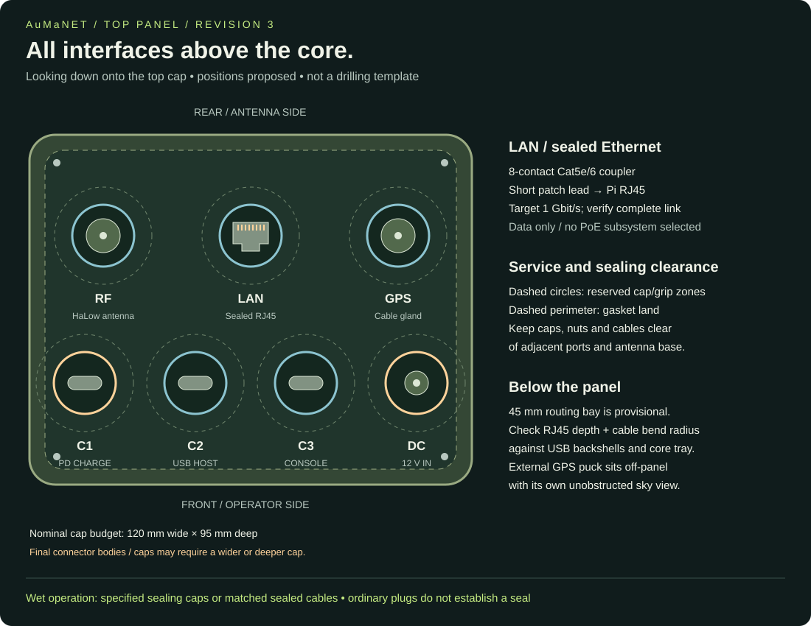

> **Historical baseline — superseded 6 November 2026.** This Pi/Heltec/OpenMANET material is retained for reference. Its “current” choices, purchasing restrictions and build steps do not apply to the active ESP32-S3/HaLow investigation. Read the [current handbook](index.md) or [archive context](archive.md).

# Operating hardware: next build stage

Reviewed 5 November 2026. One-node BOM: [parts register](parts.html), with [CSV download](../hardware/bom.csv). Purchasing remains AliExpress-only. Manufacturer/community links below are engineering references, not verified matching shopping listings. No unverified device is labelled compatible solely because its chip family matches.

## Power boundary: battery deliberately deferred

Battery cell format, count, capacity, charging and regulation are TBD. Supply regulated 5 V at **3 A continuous minimum / 15 W**, with **5 A / 25 W** an optional headroom target. Do not apply raw battery voltage or negotiate a higher voltage into Pi power. A larger supply rating does not force more current into the Pi, nor raise the Pi's USB peripheral limit. The [Pi4 manufacturer datasheet](https://datasheets.raspberrypi.com/rpi4/raspberry-pi-4-datasheet.pdf) calls for a good-quality 5 V / 3 A supply; this is not proof that our fully populated node fits 15 W. Measure boot, transmitting radio, GNSS and accessory peaks together before freezing that budget. Runtime and final battery-base dimensions remain TBD.

## Reference builds and what to take from them

| Reference | Published hardware / interfaces | AuMaNET decision |
|---|---|---|
| [Haven public project](https://github.com/buildwithparallel/haven-manet-ip-mesh-radio) | Haven 1 lists Pi4/CM4, an SPI HaLow HAT and RT5370 USB Wi-Fi. Haven 2 uses Pi5 and USB MM8108. Its case reference adds portable/vehicle mounting. | Keep Pi4 and the selected Heltec stack. Evaluate onboard Wi-Fi first; reserve USB Wi-Fi as fallback. Do not copy a Pi5 image. |
| [OpenMANET hardware](https://openmanet.github.io/docs/hardware) | Lists Pi4 onboard Wi-Fi AP support on SPI builds; USB GNSS and extra Wi-Fi are documented options. | No extra Wi-Fi adapter required by default. Keep UART GNSS candidate and verify support on our actual image. Generic support does not validate the exact Heltec HAT. |
| [OpenMANET rdt enclosure](https://github.com/OpenMANET/enclosures/blob/main/rdt_manet_enclosure/README.md) | CM4 carrier, separate Wi-Fi6E card, USB HaLow, multiple RF ports, rugged Ethernet and panel USB/power. | Borrow cable-clearance, bulkhead and heat-path ideas. Keep our sealed RJ45 and one HaLow port; its extra antennas and carrier are not needed for Pi4. Its listed 868 MHz antenna is not our selected RF kit. |
| [ties1887 modular enclosure](https://github.com/ties1887/Mesh-radio-Halow-LoRa) | P4-Wio uses Pi4, WM1302 HAT and Wio-WM6108; publishes mechanical source and print files. | Retain preferred bottom/core/top styling. Adapt mounting for Heltec rather than assuming the Wio carrier fits. Battery-base internals remain TBD. |

The likely Data Slayer reference is [I Built a $20,000 Military Router for $106.23](https://www.youtube.com/watch?v=ofR7GFNZzJY), associated with Haven. The video page was located, but a usable transcript/frame inspection was not available during this review. Hardware findings above come from the public project documentation, not an asserted frame-by-frame video BOM. The headline price and military comparison are not a delivered cost or performance specification for AuMaNET. The Haven case is linked from its project; check the actual CAD release and licence before reuse. No new upstream CAD is copied here.

## One-node operating BOM and connections

| Assembly | Quantity | Current choice / wiring | Remaining decision |
|---|---:|---|---|
| Compute | 1 | Raspberry Pi4B | Exact RAM/revision; keep selected platform |
| HaLow carrier and radio | 1 bundle | HT-HC01PHAT + HC01P V2; SPI via carrier | Received revision, overlay and calibration file; not standard PC PCIe |
| Storage | 1 | High-endurance microSD; 32 GB design allowance | Exact card and image requirements |
| Cooling | 1 set | Low-profile heat spreader/pads with external heat path | Measure HAT clearance; enclosed thermal soak |
| Mobile RF | 1 | GT-800 915 MHz candidate; short matched pigtail to SMA bulkhead | Actual microcoax plug, SMA gender, band match and installed performance |
| Camp RF | optional 1 | Existing fiberglass omni/mast/feed candidate | Feed loss, support and operating profile; swap with mobile antenna |
| GNSS receiver | 1 | Assembled LC76G breakout; HAT P2 UART plus correct receiver supply | Exact board, VCC/logic, UART configuration and image support |
| GNSS antenna | 1 | Receiver-matched antenna and coax through sealed gland | Included antenna, connector and bias requirements |
| Ethernet | 1 set | Sealed eight-contact RJ45 coupler plus short Cat5e/6 lead to Pi | Exact coupler body, cap, seal and cable bends |
| Accessory USB | 1 set | Pi USB-A host to compliant downstream USB-C panel assembly | Correct host signalling; both orientations; driver support for chosen headset |
| Regulated power feed | 1 | Future 5 V battery output to Pi internal USB-C | Short rated harness and loaded voltage; battery implementation deferred |
| Charging interface | 1 reserved | Top USB-C CHARGE | Connector/protocol must follow future battery choice |
| Controls | 1 button + status set | Sealed power/shutdown button; power/link/battery indication | Controller and GPIO allocation; battery indication source deferred |
| Mechanical | 1 set | Core tray, spacers, screws, inserts, gasket, port caps, cable clamps, mounting/tether | Measure and freeze exact quantities with CAD |
| Phone | at least 1 per user/group | Onboard Wi-Fi AP to chosen offline mapping/comms app | ATAK/other app, voice routing and locked-screen tests |

A GNSS **antenna is not a receiver**. The LC76G converts satellite signals into UART position data; the HAT's exposed UART carries that data to the Pi. No direct GNSS-antenna-to-UART connection is possible.

Use the [existing antenna detail](../hardware/antennas.md) for the two interchangeable RF kits. No camera, screen, LoRa sidecar, extra MIMO antennas or dedicated audio socket is required for the initial voice/data node. Use phone audio first; trial a digital USB headset later through the accessory port. Retain the blanked headset/PTT position.

## Freeze these decisions next, in order

1. **Core compatibility bench:** one Pi4 + exact Heltec bundle + microSD on a known supply. Resolve the already documented GPIO overlay/calibration mismatch before calling the firmware recipe ready. Then verify a second node can exchange IP traffic.
2. **GNSS and antenna harness:** obtain receiver dimensions/pinout and actual radio socket identification; fix connector part numbers, cable lengths and power draw. Verify GNSS outdoors and compare node position with phone position.
3. **Top-panel parts:** select actual sealed RJ45, USB-C host assembly, charging provision, SMA bulkhead, GNSS gland, button and caps. Record panel thickness, nut access and connector backs. Keep current top layout as a concept, not a drilling template.
4. **Dry-fit core and cooling:** measure Pi/HAT height, heat spreader, UART plugs and cable bends. Add mounting hardware and strain relief to CAD. Battery volume stays a reserved removable zone until selected.
5. **Two-node application trial, then three-node relay:** exercise offline message/position/voice with phone sleep, loss/rejoin and radio traffic while logging voltage and temperature. Finalise accessory demand and required supply headroom from measurements.
6. **Release mechanical files and exact shopping BOM:** populate model/revision/listing, received dimensions, quantities and fit photos. Freeze printable carrier/top only after the real parts fit. Battery work resumes later against the stable 5 V requirement.

The immediate purchase/identification gaps are **GNSS receiver kit, RF pigtail, cooling, sealed panel assemblies, internal leads and mounting hardware**. Complete BOM rows now exist for these; listing-level selection and physical qualification are still pending.

## Active cellular and top-panel revision 7

The user now includes a **Sierra EM7430 on a USB WWAN adapter** as the cellular/GNSS candidate. It is not a PCIe data connection to the Pi: the adapter carries USB, SIM and module power. Internet uplink is the purpose; native carrier calls and SMS features are outside this project's scope. Exact adapter, firmware, carrier operation, GNSS output and power remain verification items.

| Position viewed from above | Interface | Internal destination |
|---|---|---|
| Rear left | HaLow antenna bulkhead | Existing Heltec radio through its verified matching pigtail |
| Rear right | LTE MAIN antenna bulkhead | EM7430 MAIN coax socket |
| Front left | LTE AUX antenna bulkhead | EM7430 AUX diversity/MIMO coax socket |
| Front right | GNSS sealed coax exit | EM7430 dedicated GNSS socket; cable to compatible sky-facing patch/puck |
| Centre rear | Sealed Ethernet | Short eight-contact patch cable to Pi LAN |
| Centre front left | C1 USB-C CHARGE | Future battery charging system; protocol TBD |
| Centre front right | C2 USB-C ACCESSORY HOST | Compliant downstream host interface from Pi USB |

Four RF paths are reserved, not necessarily four upright antennas. GPS may use a remote puck through the gland. LTE MAIN and AUX need two suitable cellular elements; they do not share the HaLow antenna. Exact microcoax mating parts, bulkhead seals, LTE band coverage, GNSS bias and cable loss must be selected from the actual module/antenna documentation. Keep short, strain-relieved coax runs.

The **Pi4 onboard Wi-Fi/Bluetooth antenna** provides local access; no new Bluetooth or Wi-Fi bulkhead is included. Keep its antenna area away from metal heat spreaders, battery and cabling, and verify phone access through the case. No GPIO antenna pinout is involved. Bluetooth phone networking is not assumed or required.

Corner placement maximises available separation within this concept, but proves no RF isolation. Test GNSS acquisition/fix retention during LTE uplink and HaLow traffic, LTE signal/throughput with both elements, and local Wi-Fi. The 120 x 95 mm cap is still a provisional envelope: check seven interface bodies, caps, nuts, fingers, gasket and cable bends before freezing CAD. Resize if necessary; no hole coordinates or drilling diameters are released. Power button/PTT blank remain on the upper side and status windows remain near the top shoulder.

**GNSS replacement:** EM7430 GNSS is the integrated candidate; LC76G becomes a fallback. Confirm position data over USB and operation without a SIM or cellular service before removing the separate receiver from the build. Verify selected image modem drivers, routing/failover to cellular without breaking local mesh, SIM/APN, reconnection, power/thermal peaks and antenna coexistence. Battery internals remain TBD behind the regulated 5 V supply boundary; the previous 15 W minimum is not proof of sufficient capacity with LTE.

Technical source: [Sierra EM7430 hardware specification](https://source.sierrawireless.com/resources/airprime/minicard/74xx/airprime_em7430_product_technical_specification). These are concept positions, not final electrical wiring or fabrication drawings.
