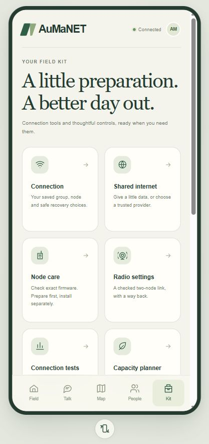
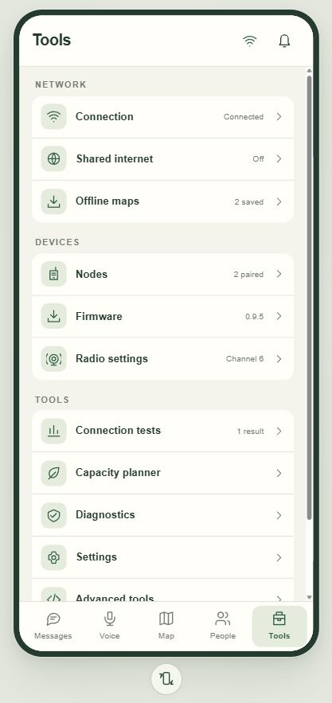
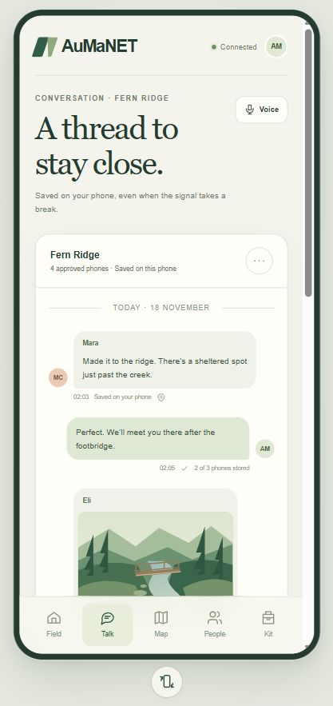
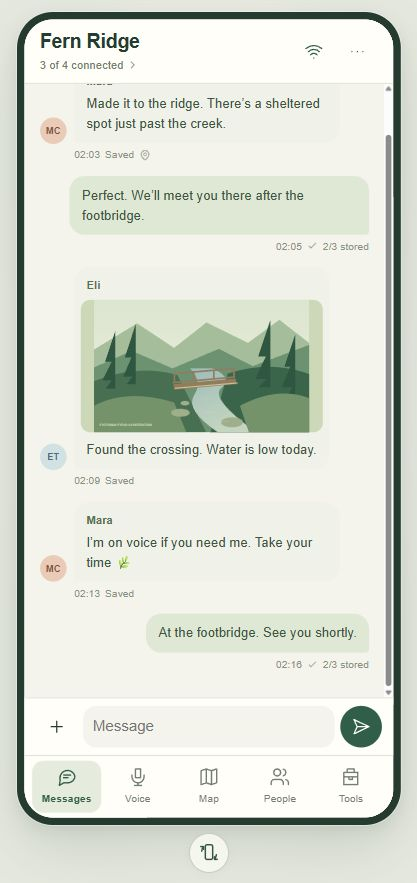
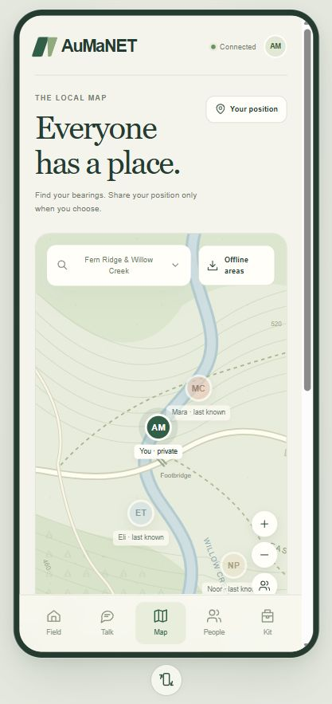
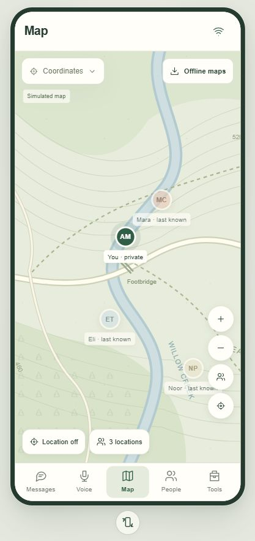
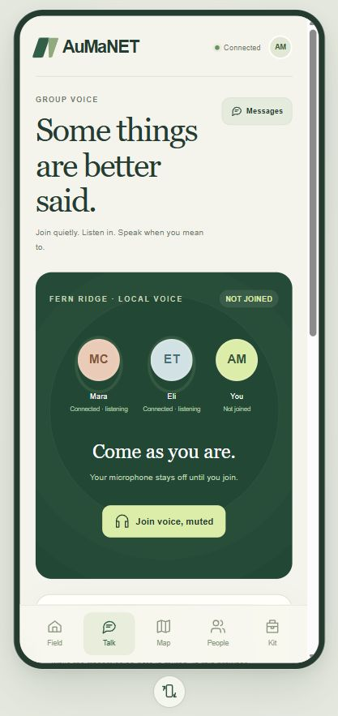
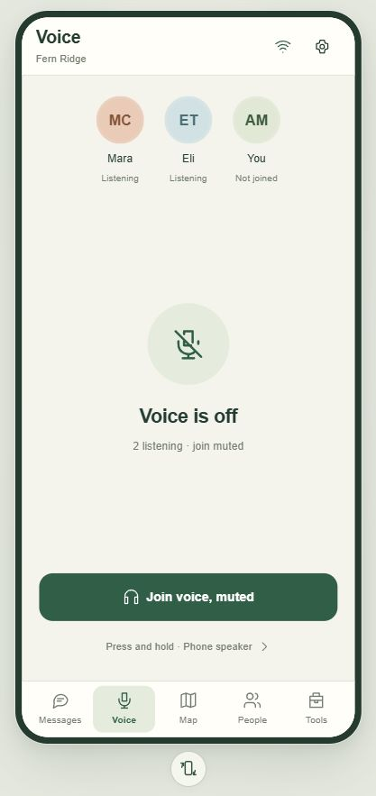
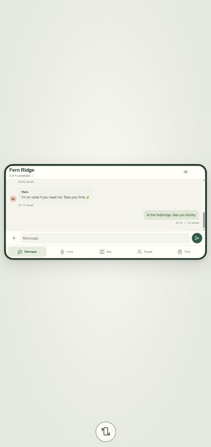

# Mobile UX review and correction

Reviewed 18 November 2026 against the independent prototype at `aab6736599b96d64cbc97df348a5d674f7456f00`. The user's objection was correct: the phone frame contained long website-style pages, rather than an application arranged around its tasks. This follow-up uses only the existing independent prototype and that feedback; the original application's implementation and visuals were not consulted.

The revised [live mobile preview](http://127.0.0.1:4317/mobile.html#chat) has five direct destinations: Messages, Voice, Map, People and Tools. The viewport contains a compact app bar, the active screen and persistent navigation. Promotional headings, repeated introductions and footer copy have been removed from the rendered app. Necessary status, consent, errors and recovery actions remain.

## 1. Find a tool

**Before: high friction. After: improved in the inspected flow.** The Tools page spent its first screen on a slogan and large cards. It now uses grouped rows with brief, current status. Ten destinations are visible in the captured portrait view, with the remaining entries available in the same screen scroller. Back navigation returns from secondary tools. Explanations use optional disclosures; they no longer precede routine controls.

## 2. Read and send a message

**Before: task-blocking layout. After: improved and interaction-checked.** At 390×844, the old conversation document was 1,927px tall and the composer required page scrolling. The portrait capture reproduced page scrolling; the old desktop CSS also provided an independent history scroller. The replacement has one scrolling message history, with the composer and navigation outside it. The document remains 844px tall. History position is retained across navigation; a view already at the latest message remains there through rotation.

Multiline typing, rotation, sending and failure recovery were exercised. A storage fault kept the draft and produced no message; inline Retry recovered it, and the subsequent send created one message and returned focus to the composer. Stored-device counts remain distinct from human read receipts.

## 3. Use the map

**Before: high friction. After: improved in the inspected flow.** The heading and introduction displaced the map and its controls below the first viewport. The map now fills the space between app bar and navigation. Coordinates, offline maps, zoom, group fit, own location and location status remain directly reachable. Member locations open in a sheet rather than extending the page below the map. Opening the sheet makes the background inert; closing restores access to the app.

## 4. Join and use voice

**Before: high friction. After: improved and interaction-checked.** The introduction, large presentation card and explanatory panels pushed the call workflow down the page. Voice now places participants, call state and speaking controls on one screen. Joining remains muted; enabling the microphone is explicit. Sound, mute and leave controls stay reachable. A persistent voice strip provides mute and leave when another destination is open. Settings live in a sheet.

Join muted, enable microphone, keyboard press/release, navigation during a session, mute, audio-output preference and leave were checked. Portrait and landscape layouts fit without outer page scrolling. At 320×640 the voice controls ended at y=560, above navigation at y=574.

## Responsive and accessibility checks

- At 390×844 and 844×390, conversation document dimensions matched the viewport. The composer ended exactly where navigation began; there was no overlap or horizontal overflow. A separate 320×640 check confirmed the same layout contract.
- The landscape preview scales to the available pane. This capture shows the actual narrow desktop pane, not a larger substituted canvas:

- Connection, firmware, radio, offline maps, planner, settings and diagnostics were inspected for reachable controls and screen scrolling. Secondary screens use one vertical scroller; long tables can scroll horizontally. The planner now presents the estimate first, four core inputs next, and detailed assumptions in a disclosure. Changing talkers from two to three recalculated demand from 65 to 98 kbit/s.
- Main icon controls have accessible names; navigation identifies the active destination. Inputs use 16px text. Primary controls and inline draft Retry provide at least 44px height. Existing focus outlines, Escape handling, dialog focus containment, and keyboard press/release are retained. Background controls become inert while a sheet is open.
- These are targeted browser and accessibility-tree checks, not a screen-reader or WCAG certification. Actual Android/iOS soft-keyboard behavior, safe areas and assistive technology require device validation. The layout listens to the visual viewport and requests content resizing, but a desktop phone frame cannot establish those native behaviors.

## Evidence and limits

All nine images above were captured in this review. Before captures show the earlier implementation; after captures show the replacement. Existing gallery/showcase image files elsewhere in the experiment remain historical evidence and do not describe the revised layout. The live showcase uses the current renderer.

The existing 47 model/persistence checks, JavaScript syntax checks and whitespace validation pass. No model, firmware or native transport behavior changed. Hardware, GPS, audio, permissions and peers remain simulated; the coverage map retains its partial and descriptive limits. The independent prototype remains a separate experiment in open PR #13 targeting `testing`.
