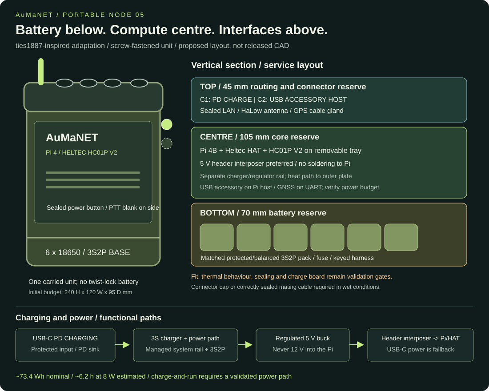

# Portable Pi 4 radio: enclosure, battery and GPS

Design baseline, 2026-11-05. User-selected core: Raspberry Pi 4B + Heltec HT-HC01PHAT + HC01P V2 (902-928 MHz). This is a packaging and integration proposal, not a released print or verified assembly.

## Enclosure choice

Use the **OpenNot5 military-radio style** as the community reference: protective shoulders, top antenna, recessed connectors and removable service panel. Its upstream build uses Pi 4, a WM1302 carrier and a different radio; it is not a proven drop-in fit for the Heltec HAT. Start with an custom adapted body and a new internal carrier rather than printing the stock shell and hoping it fits. OpenChubNET is an alternative community chassis, but its UPS D layout is a different power architecture.

- [Pinned OpenNot5 folder and STL files](https://github.com/OpenMANET/enclosures/tree/523bd28d7d4d13216945864ec77e8698ddc7b4c9/OpenNot5)
- Body: `obj_1_openMANET main body .stl`; service panels: `obj_2_openMANET back panel .stl` and `obj_3_openMANET front panel.stl`.
- [MakerWorld original project](https://makerworld.com/en/models/2128181-openmanet-radio-case)
- Check the selected design's licence before remixing; the upstream enclosure catalogue states CC BY-NC 4.0. This project has not copied or modified upstream CAD.

### Proposed packaging envelope

Reserve **240 x 120 x 95 mm external** and **230 x 110 x 85 mm clear internal** for a larger field-radio body. These are original design allowances, not dimensions measured from the upstream STL. They exclude external antenna, GPS puck, knobs and mounting ears. A smaller finished enclosure may be possible after physical measurement.

Split the internal length into a 100 mm electronics bay and a 120 mm battery bay with a 5 mm insulating divider and 5 mm remaining clearance. Use a continuous service lid and separate removable trays:

| Zone | Reserved envelope | Contents and constraints |
|---|---|---|
| Electronics | 100 x 75 x 50 mm | Pi 4 underneath Heltec HAT and radio. Leave connector service access and verify all header/standoff heights. |
| Battery | 120 x 75 x 55 mm | Six-cell professionally assembled 3S2P pack, balancing BMS and connector in an insulated removable tray. Reserve space for a separate regulator beside/above it, away from the cells. Confirm actual supplier drawing. |
| Cable aisle | Remaining internal width | Short USB-C power lead, USB GPS lead, antenna pigtail and optional I2C harness. Connector bend radii can require a larger shell. |

The Heltec HAT product page gives 90 x 50 x 20 mm under product characteristics; treat that as a conservative procurement envelope, not a reliable mechanical drawing. The radio is about 50.95 x 30 x 3.75 mm. Measure the assembled Pi/HAT/radio, connector overhangs and cables before releasing a carrier or STL. Mount the HAT directly on the Pi's supported header/standoffs; the battery board is mounted separately and does not occupy that header stack.

Use a flat conductive heat-spreader coupled to the Pi CPU with an electrically insulating thermal interface, without shorting the HAT. Keep battery cells away from the hot plate. For a printed body, provide a deliberate heat path to an external metal plate; sealed plastic is not assumed to cool the Pi. Use ASA as a print-material candidate after printer/material validation. Gaskets, bulkheads and print porosity need weather testing; no military or IP certification is claimed.

## Six-cell battery system selection

The user selected **six 18650 cells**. Use a professionally assembled **3S2P Li-ion pack**: three series groups, each containing two parallel cells. This gives **10.8 V nominal / 12.6 V full**, and **6.8 Ah** when using 3.4 Ah cells rated at 3.6 V nominal. Six cells in series would be a different 25.2 V full pack and is not this design.

Procure the complete pack from a reputable pack builder, including matched genuine cells, a **3S balancing BMS**, temperature sensing/charge inhibit, insulated terminals, suitable fuse, strain relief and a keyed connector. Specify at least 5 A continuous pack discharge capability, with protection limits, connector and wiring coordinated by the pack builder. Select charge current from the actual cells and pack specification; a matched 12.6 V CC/CV Li-ion charger up to 2 A is the starting requirement, subject to that approval. A BMS is not a charger. Do not assemble this as six loose cells in generic spring holders or connect extra cells to a three-cell UPS holder.

**Power path:** protected 3S2P pack -> fuse/master disconnect -> **Pololu D24V50F5 regulated 5 V buck** -> short suitable USB-C power harness -> Pi 4 -> Heltec HAT and USB GPS. Pololu publishes a typical output capability up to 5 A, subject to thermal derating; measure the delivered voltage and current at the Pi. Its fixed 5 V output tolerance and cable losses must be checked at maximum load; reject the harness/regulator combination if it causes undervoltage. The 5 A headline is not a guarantee of operation in a sealed hot case. This small regulator leaves the GPIO header free for the Heltec HAT.

The previously considered **Waveshare UPS Module 3S is superseded** for this six-cell baseline: its supplied holder is for three cells, and external 3S2P adaptation is not established by its product documentation. No unverified holder modification is part of this design.

### Runtime estimate

6 x 3.6 V x 3.4 Ah = **73.4 Wh nominal**. At an assumed 85% conversion efficiency and leaving 20% reserve, about **49.9 Wh** is available to the load:

| Load assumption including GPS/radio | Estimated operation with reserve |
|---|---|
| 6 W | 8.3 h |
| 8 W design assumption | 6.2 h |
| 10 W | 5.0 h |

These are calculations, not test results. Age, temperature, BMS cutoff and radio duty cycle affect runtime. Six cells still do **not** establish the 12 h target at 8 W: the same budget requires about **141 Wh nominal**. Treat the internal pack as the portable baseline and retain an external supply option for all-day use. Runtime testing decides whether the earlier 12 h acceptance target needs a larger pack or a reduced load.

### Charging and power control

Baseline operation uses **shutdown, power isolation, then charging** with the pack maker's matched charger. The charging connector and wiring must follow the actual BMS port arrangement. A physical interlock or equivalent verified disconnect should prevent the Pi load being connected while charging. This avoids claiming charge termination or seamless UPS behaviour without a power-path controller. Unplug the charger before returning to battery operation. Simultaneous charging/running and automatic source switchover are **not implemented** in this baseline; a managed load-sharing controller is a separate design change.

Label the charge inlet **12.6 V Li-ion charger only** and keep it mechanically distinct from Pi USB service. No raw 9-12.6 V rail goes to the Pi, USB-C or 3.3 V radio. Vehicle charging requires an automotive-rated charger suitable for this pack, with fused input and transient protection; an unregulated cigarette-lighter feed is not acceptable as a charger.

Use a graceful Linux shutdown command before master disconnect. A later momentary shutdown button must use a GPIO verified spare against the Heltec HAT schematic. Add a battery monitor/fuel gauge compatible with 3S packs and 3.3 V host logic; exact part and OpenWrt integration remain procurement/development gates. A voltage-only percentage is an estimate. Set warnings/shutdown above BMS hard cutoff based on actual load tests and cell specifications. Do not feed a raw pack-voltage divider into a Pi GPIO; the Pi has no built-in analogue input.

## GPS selection and location behaviour

Use a **GlobalSat BU-353N (10 Hz) USB GPS puck** as the concrete procurement candidate, with exact product suffix verified. Manufacturer documentation describes USB-powered NMEA 0183, default 115200 baud, a magnetic puck and built-in antenna. Its manual gives a 53 mm diameter x 19.2 mm body, 1.5 m cable and 42 mA typical at 5 V. This is a GPS/SBAS product; do not substitute BU-353N5 or another variant while retaining these specifications.

Mount the puck **outside the case** with a sky view, using a cable gland/split gland sized for its cable and USB connector, or an appropriately rated sealed USB bulkhead. A metal case or roof between it and the sky will impair reception. Provide a removable top bracket for handheld use and a roof mount option for vehicles. The puck is the receiver and antenna together; a passive GPS antenna alone cannot replace it. Keep it separated from the HaLow antenna and verify reception while transmitting. Store excess cable without tight bends or pressure on the connector.

Connection: Pi USB 2 port -> USB serial device -> gpsd -> OpenMANET local receiver source. Exact USB bridge/driver support for this GlobalSat model on the pinned OpenWrt image must be bench verified; NMEA support alone is not proof. Upstream explicitly documents gpsd-compatible u-blox USB receivers, so a genuine u-blox USB unit is the fallback if the GlobalSat driver is unavailable. Record VID/PID and stable device mapping instead of assuming `/dev/ttyUSB0` remains constant.

Validate cold boot, fix acquisition, disconnect/reconnect, fix loss, UTC and position age. Node GPS locates the **radio**, not a person who walks away from it. Phone/person location remains a separate source. GNSS position/time is not assumed to discipline the system clock until the clock service is configured and tested.

## Panel and harness layout

- Top: HaLow bulkhead with a short, correct-connector pigtail; external GPS puck bracket/cable exit on the opposite side. Bulkhead connector type must match the chosen antenna and module pigtail.
- Service side: recessed USB/Ethernet access and labelled charger inlet, with sealed caps where appropriate. Keep GPS USB and Pi USB-C power entirely inside except their deliberate feedthroughs.
- Rear: removable battery tray cover, captured screws and belt/vehicle mounting points; preserve clearance for cell replacement without disturbing RF wiring.
- No screen is included in this baseline. A screen would change panel layout, load and thermal requirements.

## Verification required before printing the final body

1. Bench-run the exact Pi 4/HAT/V2 image and calibration combination with GPS, protected 3S2P pack and regulator. Confirm 3.3 V radio supply capacity; the radio is supplied through the verified Pi/HAT power path.
2. Record all real assembled dimensions, connector bend radii, antenna retention, screw lengths and HAT clearances. Print a carrier/cross-section fit coupon first.
3. Measure voltage at the Pi during boot, sustained radio TX and GPS acquisition. Check for undervoltage, resets and backfeed; measure current at low pack voltage.
4. Verify graceful shutdown, hardware cutoff recovery, charging with the load isolated, and the charging interlock. Log battery/CPU/regulator temperatures during their respective charge and radio operating modes; follow the cell maker's charge-temperature range rather than the radio's wider temperature rating.
5. Validate GPS driver/gpsd/OpenMANET output and stale-location behaviour with the lid closed and radio active.
6. Conduct mounting, vibration, cable pull and controlled weather tests; no waterproof claim before testing. Re-run the project relay and message tests.

## Primary references

- [OpenNot5 build reference](https://github.com/OpenMANET/enclosures/blob/523bd28d7d4d13216945864ec77e8698ddc7b4c9/OpenNot5/README.md)
- [Heltec HAT](https://heltec.org/project/ht-hc01p-hat/) and [V2 module](https://heltec.org/project/hc01p-v2/)
- [Pololu D24V50F5 regulator](https://www.pololu.com/product/2851)
- [Raspberry Pi supply recommendations](https://www.raspberrypi.com/documentation/computers/getting-started.html)
- [GlobalSat BU-353N 10 Hz](https://www.globalsat.com.tw/en/product-289513/USB-GPS-Receiver-BU-353N-10Hz.html) and [manufacturer manual](https://www.globalsat.com.tw/files/10Hz_User%20Manual-BU-353N_BR-355N%20V1.1_20240912.pdf)
- [OpenMANET GNSS integration](https://openmanet.github.io/docs/gnss)
