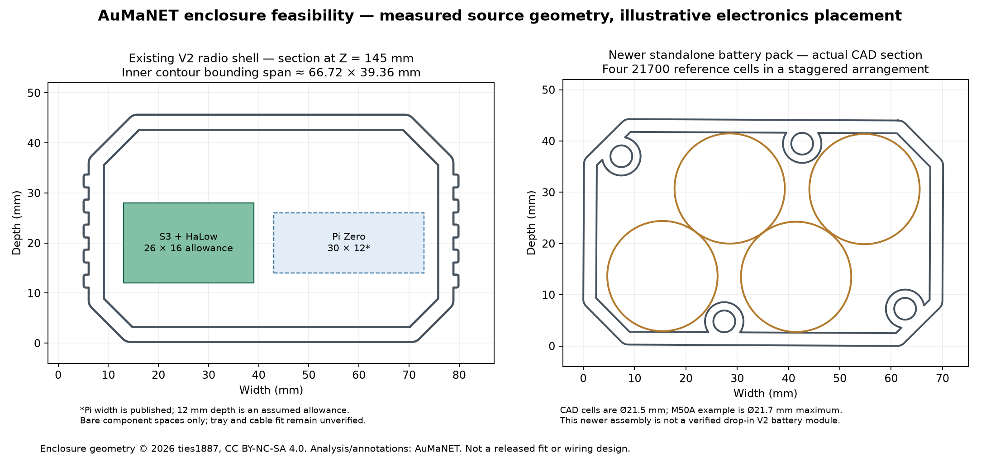

# Rugged radio enclosure feasibility

Reviewed 6 November 2026 for the ordered plain XIAO ESP32-S3 + Seeed XIAO HaLow carrier. This is a feasibility assessment, not a selected battery circuit or released enclosure adaptation. No printable CAD, canonical STL, part selection or print bundle was changed.

## Recommendation

**Adapt the existing ties1887 case family. Use a replaceable S3/HaLow tray, a simpler top connector plate, and a four-21700 battery module as the first layout to validate.** Retain provision for a Pi Zero 2 W tray and an expanded six-cell battery module. Keep the Pi optional and separately switchable so an unused Linux computer does not consume the radio's endurance budget.

The military-radio appearance is straightforward to retain: tall ribbed polymer body, olive/black colour scheme, recessed fasteners, gasketed service covers, protected antenna bases and a replaceable battery compartment. The useful adaptation is the internal mounting and connector layout; uniformly scaling the whole case would also change joints, screw fits and seal geometry unnecessarily. Appearance alone does not establish an ingress, impact or military-standard rating.

## What already exists

The linked repository's current `main` resolves to **f0d285c67bc893ddacc5d8121fe1c92385cd54fb**, the same revision already imported into AuMaNET. Primary references:

- [Upstream overview and build comparison](https://github.com/ties1887/Mesh-radio-Halow-LoRa/blob/f0d285c67bc893ddacc5d8121fe1c92385cd54fb/README.md).
- [V2 build](https://github.com/ties1887/Mesh-radio-Halow-LoRa/tree/f0d285c67bc893ddacc5d8121fe1c92385cd54fb/First-Generation-Builds/V2_30-5-2026): already available locally as the author's unmodified STL set and equipment viewer. Best route to reuse our present assets.
- [P4-Wio](https://github.com/ties1887/Mesh-radio-Halow-LoRa/tree/f0d285c67bc893ddacc5d8121fe1c92385cd54fb/Second-Generation-Builds/P4-Wio): current second-generation Pi 4/HaLow-only design, with separate main chassis, front cover, top cover, gaskets and native SolidWorks archive. Attractive starting point for a more extensive revision or a Pi 4 configuration.
- [Standalone battery pack](https://github.com/ties1887/Mesh-radio-Halow-LoRa/tree/f0d285c67bc893ddacc5d8121fe1c92385cd54fb/Twist-Lock-Battery-Pack): separate four-cell mechanical assembly; shared design intent across generations, but exact interface fit between exported revisions still needs checking.
- [V1](https://github.com/ties1887/Mesh-radio-Halow-LoRa/tree/f0d285c67bc893ddacc5d8121fe1c92385cd54fb/First-Generation-Builds/V1_5-5-2026): first large prototype with an integrated battery. A deeper alternative, but not required merely to accommodate the S3.

The supplied photo is consistent with this family of prototypes. It cannot establish precise dimensions or the identity of every pictured revision. Dimensions here come from the actual files instead of scaling the photo.

## Measured geometry and likely board fit

All dimensions are mm. Different STEP parts use different native axes; the descriptions below identify orientation. Bounding spans are not usable internal cuboids.

| Reference | Measured size | Interpretation |
| --- | --- | --- |
| Existing V2 combined STL set | **83.96 wide × 50.00 deep × 209.05 tall** | Collective bounds of locally pinned parts, excluding antennas. It includes original hardware references, which remain inside the case envelope. |
| V2 radio body `base-1` | **83.96 × 50.00 × 105.00** | Body only; cap and lower assembly are separate. |
| V2 battery shell `batcase-1` | **70.00 × 44.00 × 78.00** | Component bounds, not full installed pack height. |
| V2 radio section at original Z=145 | Inner contour bounding span **66.72 × 39.36** | A single section through the walls. Rounded corners, frame, bosses, top/bottom and wiring reduce space elsewhere. |
| V2 battery section at Z=40 | Inner contour bounding span **65.00 × 39.00** | Includes intrusive screw supports; cell packaging must use the real contour. |
| V1 `Base.STEP` | **82.00 wide × 59.00 deep × 115.00 tall** | Main shell component only. Its separately modeled battery cap is 75.2 × 53 × 94; assembly placement must be resolved before calculating full height. |
| P4-Wio main chassis | **70.00 wide × 51.00 deep × 109.00 along body** | Component only. Top cover native size is 24 × 70 × 51, front cover 70 × 14.5 × 105. They must be placed by assembly datums rather than summing all dimensions. |
| New standalone battery assembly | **70.14 × 44.28 cross-section, 93.10 along body** | Resolved using STEP external references. Includes cells, contacts, locking components and fasteners. Not directly comparable to V2's 78 mm battery-shell component alone. |

The [board reference pack](../seeed-xiao-esp32s3-halow/README.md) gives a provisional S3/HaLow envelope of **43.71 × 25 × 14.60**, with a **45 × 26 × 16** initial allowance. Mounted upright, the roughly 44 mm board length follows the case's tall axis. Its 26 × 16 transverse allowance is much smaller than the V2 shell section. **A replacement tray is mechanically plausible with substantial room remaining.** This has not yet been checked against every boss, antenna plug, cable, lid and received-board tolerance.

The original Pi/Wio carrier frame will not directly mount the Seeed XIAO carrier. Keep the outer case and make a new internal adapter rather than force the boards onto the old holes. The original top has excess openings for this two-radio arrangement; use a new top plate for HaLow and 2.4 GHz antenna connections and the chosen power/service interfaces. Connector nuts, backshells and cable bends belong in the fit model.

Left: actual V2 radio-wall section with illustrative component allowances. The Pi Zero's 30 mm board width is published; the displayed 12 mm depth is only an assumed packaging allowance. Full board length, plugs, mounts and thermal clearances are not represented by this section. Right: actual newer standalone battery geometry and cells. The two panels show different source assemblies and do not establish interchangeable joints.

## Battery capacity and endurance

The newer standalone STEP assembly contains **four instances of `Cell_21700`**, in a staggered arrangement. Reading only `Battery_Case_Main.STEP` or a flat photograph misses this layout. Its reference cell is **21.5 mm diameter × 70.7 mm long**. The assembly's closest modeled cell-axis spacing is about **21.531 mm**.

For a concrete energy example, the [Molicel M50A manufacturer datasheet](https://www.molicel.com/wp-content/uploads/INR21700M50A-V1-80097.pdf) specifies **5 Ah, 3.6 V, 18 Wh typical**, **21.7 mm maximum diameter × 70.2 mm maximum length**, and **68 g typical**. This is a sizing/energy example, not a purchasing decision. The stock 21.5 mm placeholder and 21.531 mm spacing do not provide clearance for a worst-case 21.7 mm cell, insulation and assembly tolerance. The cell/contact layout needs a fit pass before reuse.

Illustrative endurance assumes **80% of nominal cell energy reaches the node**, combining conversion losses, reserve and cutoff. It is not measured performance. All power columns are average **total node load**, not the S3 alone, radio peak power or power-supply rating.

| Cell count | Nominal energy | Assumed usable energy | At 1 W total | At 2 W total | At 5 W total | Cells alone |
| --- | ---: | ---: | ---: | ---: | ---: | ---: |
| 2 × 5 Ah 21700 | 36 Wh | 28.8 Wh | 28.8 h | 14.4 h | 5.8 h | 136 g |
| **4 × 5 Ah 21700** | **72 Wh** | **57.6 Wh** | **57.6 h** | **28.8 h** | **11.5 h** | **272 g** |
| 6 × 5 Ah 21700 | 108 Wh | 86.4 Wh | 86.4 h | 43.2 h | 17.3 h | 408 g |

`Runtime (hours) = cell count × cell energy (Wh) × usable fraction / average total power (W)`

For the existing **48-hour continuous-service requirement**, four cells allow at most **1.2 W average total load** under these assumptions; six allow **1.8 W**. These limits, rather than an advertised mAh figure, decide whether a proposed pack is sufficient. Continuous phone Wi-Fi, HaLow reception/forwarding, active voice and converter losses must be included in measurements. Seeed still lists HaLow operating current as TBD, so a days-long runtime cannot yet be promised.

Four cells are the strongest first mechanical candidate because the source already models them. Six cells could use an enlarged/deeper lower module or a larger integrated shell. A simple 3 × 2 arrangement of M50A maximum-size cells alone occupies **65.1 × 43.4 × 70.2**, before spacing, insulation, contacts, BMS and walls; it is not a straight drop-in to a 65 × 39 V2 cavity. Additional cells in the upper body are another possibility, but compete with the optional Pi, service access and thermal separation. Prefer a deliberately sized battery compartment.

Electrical series/parallel arrangement, charger, protection, fuse, cell retention, load sharing and regulated outputs remain to be selected together. The source's `bms 2s` model name does not validate an electrical architecture. The XIAO's onboard single-cell charging facility cannot be assumed to charge a multi-series-cell pack. [Seeed's HaLow guide](https://wiki.seeedstudio.com/getting_started_with_wifi_halow_module_for_xiao/) requires both its 3.3 V digital and 5 V RF rails; simply connecting a battery to the S3's BAT pads does not establish correct power for the full radio stack.

## Optional Raspberry Pi

A [Pi Zero 2 W](https://www.raspberrypi.com/products/raspberry-pi-zero-2-w/) has a **65 × 30 mm PCB**, making it a sensible small-Linux-computer option for a removable second tray. Reserve access to its microSD and micro-USB leads. A Pi 4 is also credible mechanically because the original case family was designed around it, but the original mounts and simplified hardware model do not prove simultaneous fit with the additional S3 stack and all cables. A CM4 needs a carrier board; its module footprint alone is not its installed footprint. Upstream's new CM4 carrier remains a development design, not a fabrication-ready shortcut.

The consequence is endurance. Raspberry Pi's [official power table](https://www.raspberrypi.com/documentation/computers/raspberry-pi.html#typical-power-requirements) gives typical bare-board active currents of **350 mA for Zero 2 W** and **600 mA for Pi 4**, roughly **1.75 W and 3 W at 5 V** before the radio and peripherals. Those are representative published figures, not measurements of this application. They show why an always-on Pi makes 48 hours from four cells difficult.

Keep S3/HaLow as the current radio node. Add a Pi only for a specific Linux function such as local services, storage, gateway experiments or diagnostics, with its own controlled power branch and clean shutdown. Physical coexistence does not establish a working Pi-to-S3 network interface, USB network firmware, Linux HaLow driver or OpenMANET compatibility; those are separate software tasks.

## Adaptation scope and next decision

The recommended next design study is **one standard-size V2-style shell, two interchangeable electronics trays, and two battery-module sizes**:

1. S3/HaLow-only tray and four-cell lower module for the first build.
2. Optional Pi Zero tray; preserve the ability to remove or switch it off.
3. Extended six-cell lower module if measured consumption needs it.

Before releasing CAD, resolve board/header fit, cell/pack dimensions and chemistry, charger/power-path module, mounting strategy, antenna/pigtail interfaces, panel connectors and service/thermal access. A screw-fastened battery interface is an alternative to copying the magnetic twist-lock contact system; it can retain the same exterior style with fewer electrical/mechanical dependencies. No choice between these joints has been imposed here.

The previous Pi/Heltec, six-18650, large-body proposals in legacy project files remain historical. This assessment does not restore them as requirements or select an always-on Pi.

## Provenance, reuse and reproducibility

Enclosure design © 2026 ties1887, **[CC BY-NC-SA 4.0](https://github.com/ties1887/Mesh-radio-Halow-LoRa/blob/f0d285c67bc893ddacc5d8121fe1c92385cd54fb/LICENSE)**. The stated licence permits attributed noncommercial adaptations with share-alike terms; a commercial enclosure based on it would need an appropriate permission/licence route. The section drawing reproduces source outlines with AuMaNET measurements/annotations and is provided under the same CC BY-NC-SA 4.0 terms.

Measurements are recorded in [measurements.json](measurements.json), including source STEP paths and SHA256 hashes. Local V2 sources are under `docs/assets/models/ties1887-v2`. Additional upstream STEP downloads were inspected in `%TEMP%/aumanet-case-research`, preserving their source directory paths and pinned revision; they were not imported into canonical print inputs. The battery assembly was resolved with OpenCascade's STEPCAF reader and all externally referenced STEP files, giving 30 solids including four cells. A simple single-file CadQuery import of its assembly index alone yields no geometry.

[analyze_sections.py](analyze_sections.py) regenerates the measurement file and drawing from the local V2 files and that cached STEP set, including the locally resolved `battery-assembled-reference.step`. It performs read-only geometry analysis and generates documentation outputs only. No print rebuild is required for this research-only change.

## Upstream BOM hardware check — 6 November 2026

A read-only CSV snapshot of the author's [shared multi-version BOM](https://docs.google.com/spreadsheets/d/1Nt8EjYsgWTId0Qjl1BAAxPci3bh1FSZ7VQxQRFxyHnk/edit?usp=sharing) is retained as `upstream-shared-bom.csv`. Its enclosure fastener row says only “M3/M4 bolts”, with no lengths or quantity. It does not supply a complete fastener kit for this adaptation. The sheet includes electronics and batteries across several builds; those rows are source context, not selected AuMaNET purchases. Use `../../print/hardware-bom.csv` for the current mechanical list and its unresolved items.
